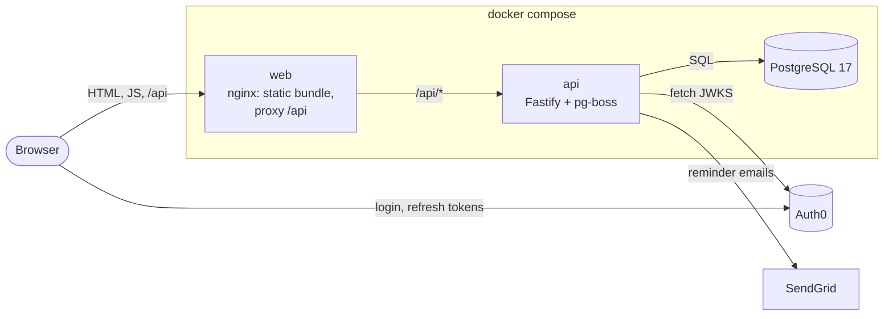
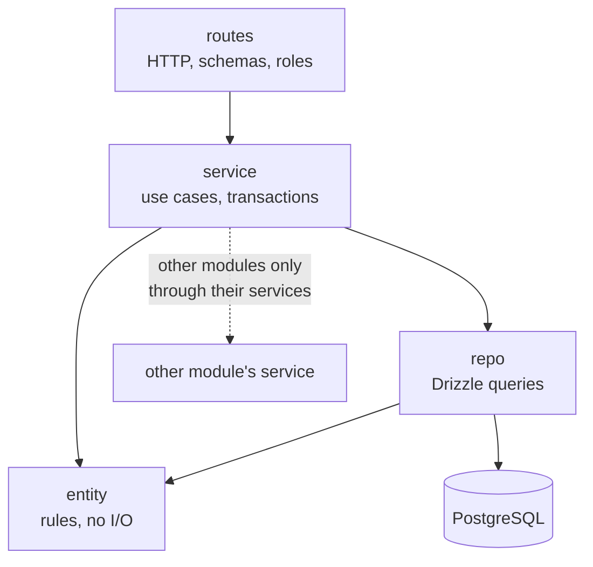
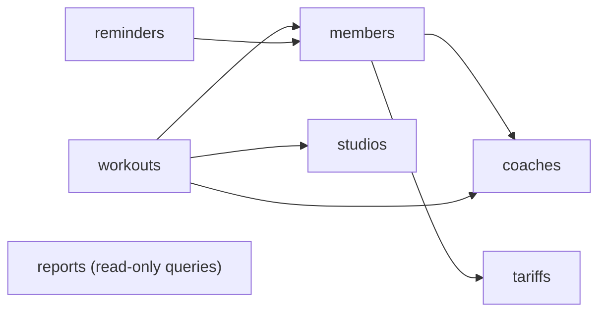
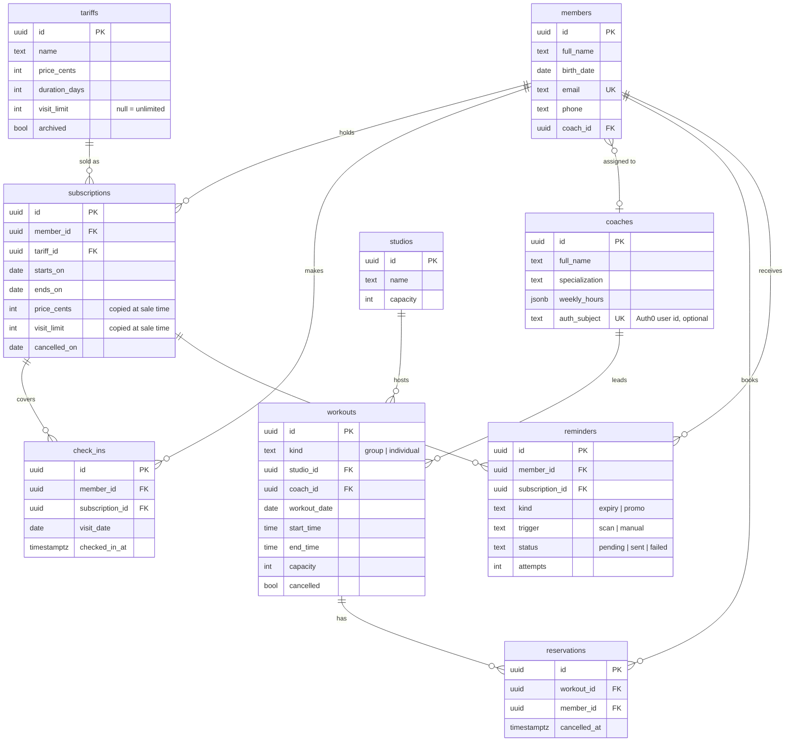
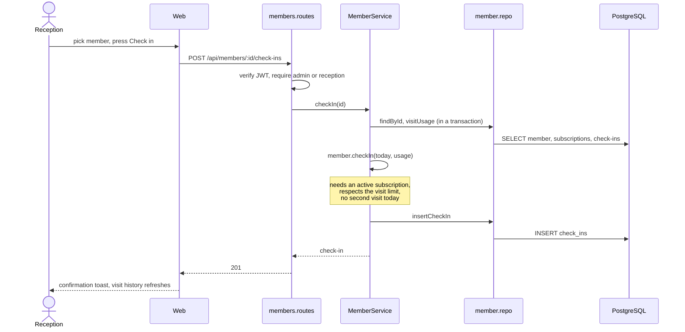
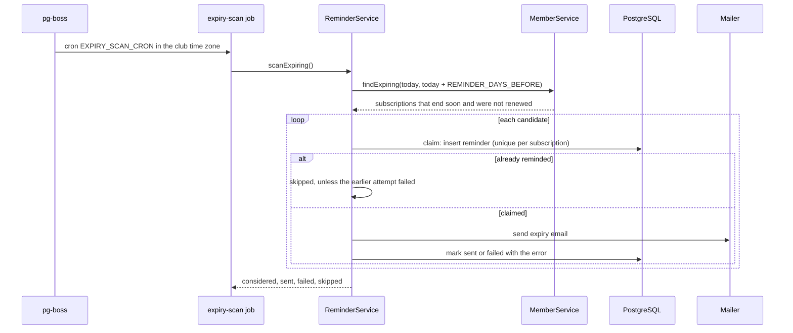
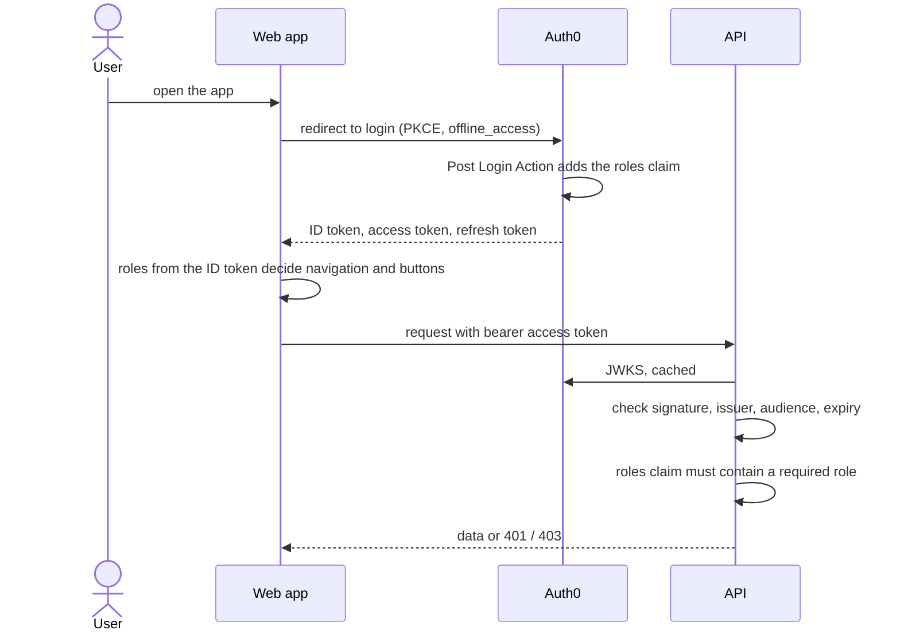

# Architecture

Gymdesk is a single-page web app in front of a stateless HTTP API and one PostgreSQL database. Users and roles live in Auth0, the API only verifies the tokens it receives.

## Deployment



- The browser only ever talks to the `web` origin, so the API needs no CORS configuration in compose. In development Vite plays the same proxy role.
- When the web app is hosted apart from the api, as on Vercel and Render, the browser calls the api directly and `CORS_ORIGIN` lists the web origin that may do so. It is empty by default.
- pg-boss keeps its queue in the same database, so there is no Redis or other broker to run. The daily scan is scheduled by the API process itself (`RUN_JOBS`).
- Without `SENDGRID_API_KEY` the mailer only logs messages. That is the default for local work and tests.

## Workspaces

| Workspace         | Contents                                                                              |
| ----------------- | ------------------------------------------------------------------------------------- |
| `apps/api`        | HTTP layer, domain modules, migrations, job scheduling, seed                          |
| `apps/web`        | React app, API client, pages grouped by feature, shadcn components                    |
| `packages/shared` | Zod schemas for requests, responses, roles and tariffs. Imported by both as TS source |

The shared schemas are the contract: the API validates requests and serialises responses with them, the web client validates every response it gets with the same objects. A change to a field breaks the build on both sides at once.

## API structure

Every domain module is a folder with the same files:

| File           | Role                                                                                         |
| -------------- | -------------------------------------------------------------------------------------------- |
| `x.ts`         | Entity: invariants and state changes in plain TypeScript, no framework imports               |
| `x.repo.ts`    | Reads and writes through Drizzle. Maps rows to entities and database errors to domain errors |
| `x.service.ts` | Use cases. Opens transactions, calls the repo and other modules' services                    |
| `x.routes.ts`  | Fastify routes: Zod schemas, role checks, calls into the service                             |



These rules are not a convention but a test. `npm run check:boundaries` runs dependency-cruiser and fails on:

- entities importing Fastify, Drizzle, `pg`, repos, services or routes;
- repos importing services or routes, services importing routes;
- a module reaching into another module's repo or entity instead of its service;
- `platform/` importing from `modules/`;
- circular imports.

### How the modules depend on each other

`src/services.ts` is the only place where modules are wired together.



`members` asks `tariffs` for a price quote when a subscription is sold, `workouts` asks `members` whether a person may reserve a place, `reminders` asks `members` who is about to expire. `reports` only reads and does not take part in any write path.

### Platform

`src/platform` holds what modules share: configuration parsing (Zod, fails fast on start), the database client and `withTx`, the clock, error types and their mapping to RFC 9457 problem responses, JWT verification, the mailer, the pg-boss queue, health and the OpenAPI document with the Scalar UI.

The clock is injected everywhere instead of calling `new Date()`. "Today" is always the date in `CLUB_TIMEZONE`, so a check-in at 00:30 local time belongs to the new day on every server. Tests pass a fixed clock.

## Data model



Rules that must never break are enforced by PostgreSQL as well as by the entities, so a race between two requests cannot get around them:

| Rule                                                         | Constraint                                                |
| ------------------------------------------------------------ | --------------------------------------------------------- |
| One check-in per member per day                              | unique index on `(member_id, visit_date)`                 |
| A member's non-cancelled subscriptions never overlap in time | `EXCLUDE USING gist` on `member_id` and the date range    |
| A studio hosts one workout at a time                         | `EXCLUDE USING gist` on `studio_id` and the time range    |
| A coach leads one workout at a time                          | `EXCLUDE USING gist` on `coach_id` and the time range     |
| A member holds at most one active reservation per workout    | partial unique index where `cancelled_at is null`         |
| The daily scan reminds about a subscription once             | partial unique index on `subscription_id` for scan-expiry |
| One sign-in account belongs to at most one coach             | unique index on `auth_subject`                            |
| Prices, durations and capacities stay in range               | `CHECK` constraints                                       |

The repos translate a violated constraint into a `ConflictError`, which the HTTP layer turns into a 409 with a readable message. Subscriptions copy price and visit limit from the tariff when they are sold, so editing or archiving a tariff never changes what a member already paid for.

## Key flows

### Check-in



### Expiry reminders



Inserting the reminder before sending is what makes the scan safe to run twice, or from two instances: only one of them can claim a subscription. A failed delivery stays visible in the reminders inbox with its error and can be retried by hand, and the next scan also retries it. The same service sends a manual expiry reminder or a promotion for one member from the member page. Failed jobs are retried by pg-boss with backoff.

### Authentication and roles



The web app hides what a role cannot use, but only the API decides: every route declares its allowed roles, and a missing or invalid token is a 401, a valid token without the right role a 403. A 401 in the browser sends the user back to login.

A coach is further scoped to their own records. `platform/scope.ts` turns the token into a scope: admin and reception see the whole club, a coach sees what belongs to the coach profile whose `auth_subject` equals the token's subject. The member and workout routes apply it, filtering lists and answering 403 for a record that belongs to someone else, and an account without a profile sees nothing. `GET /api/me` tells the web app which profile the account is linked to, so it can explain an empty view instead of leaving the coach guessing.

## Web structure

```
src/
  auth/        Auth0 session adapter, role parsing, session context
  lib/         API client with response validation, formatting, dates, config
  layout/      app shell, top bar, mobile navigation
  features/    queries, forms, dialogs and tables, one folder per area
  pages/       route components that compose features
  screens/     sign-in, loading and set-up-needed states
  palette/     the command palette with quick check-in
  components/  shadcn primitives
  nav.ts       the role table behind the menu, route guard and palette
```

- **Server state** lives in TanStack Query. Nothing from the API is copied into local state; mutations invalidate the queries they affect.
- **Routing** is TanStack Router. Filters, tabs, pagination and date ranges are search parameters, so every view can be linked, refreshed and navigated with the back button.
- **Forms** use react-hook-form with the shared Zod schemas. Field errors from a 422 or 409 response are mapped back onto the inputs.
- **Access** comes from one table in `nav.ts`: it drives the menu, the route guard and the command palette, so the three cannot disagree.
- **Status** is drawn as a weight plate whose colour follows the Olympic lifting standard (green, blue, yellow, red, plus a neutral tone). The colour is never the only carrier of meaning: every plate also has a value and a label.

## Testing

| Layer           | Approach                                                                                                                                 |
| --------------- | ---------------------------------------------------------------------------------------------------------------------------------------- |
| Entities, utils | Plain unit tests, no I/O                                                                                                                 |
| API routes      | `*.db.test.ts` start a real PostgreSQL with Testcontainers, run the migrations and call the app through `inject` with signed test tokens |
| Constraints     | Dedicated tests that provoke each exclusion and unique constraint                                                                        |
| Web             | Testing Library with MSW. A smoke matrix opens every route for every role                                                                |
| Boundaries      | dependency-cruiser rules run as part of `npm test`                                                                                       |

The same commands run in GitHub Actions (`.github/workflows/ci.yml`), followed by building both Docker images.
